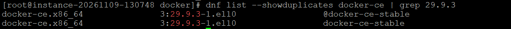
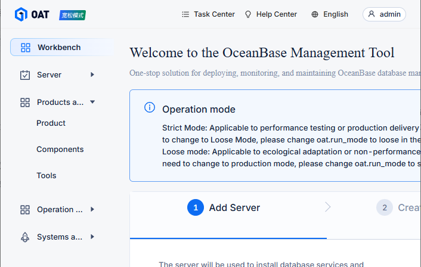
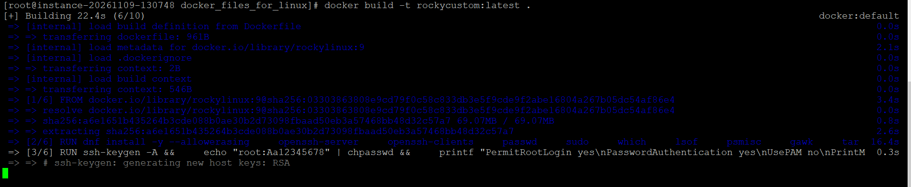

# OceanBase OAT All-In-One Component Deployment Guide on One Single Server

This is a installation guide for installation OceanBase products including OceanBase Server ,OceanBase OAT , OceanBase OCP , OceanBase OMS on a single server for OceanBase product testing and evaluation purposes. The objective is to enable every new comer from both SA , Engineer (or even BD teammate) could have hands-on experience and get more familiar with OceanBase products.

**Environment nformation for the installation.**

<table style="width:100%; table-layout:fixed;">
  <thead>
    <tr>
      <th style="width:30%; text-align:left;">Item</th>
      <th style="width:70%; text-align:left;">Value</th>
    </tr>
  </thead>
  <tbody>
    <tr><th colspan="2" style="text-align:left;">Software</th></tr>
    <tr><td>Operating System</td><td>Rocky Linux 10</td></tr>
    <tr><td>Software</td><td>Docker</td></tr>
    <tr><td></td><td>OceanBase: ocp-ob-obp-odc-oat_20260810 <a href="http://wangsg-lrb.oss-cn-hangzhou.aliyuncs.com/obpoc_20260810.tar.gz?Expires=1796567401&amp;OSSAccessKeyId=LTAI5tAjqC6KWcg3zCHTEoez&amp;Signature=JYe1MffxPc9PkxXi19lpWmgKatY%3D">Download Link</a></td></tr>
    <tr><th colspan="2" style="text-align:left;">Hardware</th></tr>
    <tr><td>CPU</td><td>16vCPU</td></tr>
    <tr><td>Memory</td><td>64GB</td></tr>
    <tr><td>Disk</td><td>230GB</td></tr>
  </tbody>
</table>

<table style="width:100%; table-layout:fixed;">
  <thead>
    <tr>
      <th style="width:35%; text-align:left;">OS Mount Point (or folder)</th>
      <th style="width:45%; text-align:left;">Purpose</th>
      <th style="width:20%; text-align:left;">Size Estimation</th>
    </tr>
  </thead>
  <tbody>
    <tr><td>/data/docker</td><td>Docker Images and container locations</td><td>100GB</td></tr>
    <tr><td>/data/observer_data/observer[*]/data/1</td><td rowspan="3"></td><td rowspan="3">40GB</td></tr>
    <tr><td>/data/observer_data/observer[*]/data/log1</td></tr>
    <tr><td>/data/observer_data/observer[*]/home/admin</td></tr>
    <tr><td>/data/ob_software</td><td>OceanBase software packages</td><td>30GB</td></tr>
    <tr><td>/data/oat_data</td><td>OAT docker volume to store OAT data and also the OCP, OMS docker images and other Oceanbase rpm packages</td><td>10GB</td></tr>
    <tr><td>/data/influxdb</td><td></td><td>1GB</td></tr>
    <tr><td>/data/metadb</td><td>MetaDB Docker volume to store OCP and OMS database data</td><td>100GB</td></tr>
    <tr><td>/data/oms/home/admin</td><td rowspan="2"></td><td rowspan="2">10GB</td></tr>
    <tr><td>/data/ocp/home/admin</td></tr>
  </tbody>
</table>

---

## 0. Basic Linux Setup
#### Enable ssh password authentication

Execute the following to ensure root can be used to login to server through ssh using password. And ensure sshd statup after server restart.

```
### Reset root password
passwd root


mkdir -p /etc/ssh/sshd_config.d && \
cat << 'EOF' > /etc/ssh/sshd_config.d/00-root-password.conf
PermitRootLogin yes
PasswordAuthentication yes
EOF
sed -i 's/^[#[:space:]]*PermitRootLogin.*/PermitRootLogin yes/' /etc/ssh/sshd_config
sed -i 's/^[#[:space:]]*PasswordAuthentication.*/PasswordAuthentication yes/' /etc/ssh/sshd_config


systemctl enable sshd && systemctl restart sshd
```


## 1. Docker Setup
Run the following command to install Docker
```bash
dnf install -y dnf-plugins-core
dnf config-manager --add-repo https://download.docker.com/linux/centos/docker-ce.repo
dnf list --showduplicates docker-ce | grep 29.9.3
```




Install Docker : 
```bash
dnf install -y \
  docker-ce-29.9.3* \
  docker-ce-cli-29.9.3* \
  containerd.io \
  docker-buildx-plugin \
  docker-compose-plugin
```

Create /data/docker, write /etc/docker/daemon.json before starting the service, apply SELinux file contexts if SELinux is active, and enable Docker:
```
mkdir -p /data/docker /etc/docker && \
cat << 'EOF' > /etc/docker/daemon.json
{
  "data-root": "/data/docker"
}
EOF

if command -v semanage >/dev/null 2>&1; then
  semanage fcontext -a -e /var/lib/docker /data/docker
  restorecon -Rv /data/docker
fi

systemctl enable --now docker
```


Create a dedicated docker network for observers. This is to ensure the container can have a fix IP.
```
docker network create --driver bridge --subnet=172.20.0.0/24 --gateway=172.20.0.1 
```


## 2. OAT Setup

#### Upload OceanBase Softwares
Download the obpoc_20260810.tar.gz and upload to server /data/ob_software. Download winscp and 
```
mkdir -p /data/ob_software
tar -zxvf obpoc_20260810.tar.gz
```

#### Install OAT
Go to /data/ob_software/{path of the unzip}/oat/oat-all-in-one-x86
```
cd /data/ob_software/{path of the unzip}/oat/oat-all-in-one-x86
./install.sh
```
and following instruction to input the information:

<need to input Images>

#### Verify OAT Access
Access OAT using http://IP_of_server:7000. Login using admin 



## 3. Add and Prepare Host Servers
Before adding servers in OAT, update the system parameter configuration to ignore missing host package dependencies (such as legacy `python2`).

1. Navigate to **Systems and... (系统与安全)** $\rightarrow$ **System parameters (系统参数)**.
2. Locate `oat.server.ignore_deps` in the parameter table and click **Modify**.
3. Change the parameter value from `["python3"]` to `["python3","python2"]`.
4. Click **Sure**.

<to be provide images>

### Add server steps.

## 2 Linux Server Setup
## 2 Linux Server Setup
## 2 Linux Server Setup
## 2 Linux Server Setup
## 2 Linux Server Setup
## 2 Linux Server Setup

## 1. Add Server in OAT

OAT System Parameter Configuration (Bypass Server Dependency).
Before adding servers in OAT, update the system parameter configuration to ignore missing host package dependencies (such as legacy `python2`).

1. Navigate to **Systems and... (系统与安全)** $\rightarrow$ **System parameters (系统参数)**.
2. Locate `oat.server.ignore_deps` in the parameter table and click **Modify**.
3. Change the parameter value from `["python3"]` to `["python3","python2"]`.
4. Click **Sure**.

![System Parameters Ignore Dependencies][img_system_params]

---

## 2. MetaDB Installation & Configuration

MetaDB serves as the metadata database cluster for OAT and OceanBase management services.

### 2.1 Installation Paths
In the MetaDB deployment wizard, set the following disk paths:

* **Installation Directory:** `/data/admin/oceanbase`
* **Data Directory:** `/data/medadb/data/1`
* **Log Directory:** `/data/medadb/data/log1`
* **Backup Directory:** *(Optional / Leave Blank)*

![MetaDB Installation Paths][img_metadb_paths]

### 2.2 Server Resource Allocation
Select the target host and assign adequate system resources:

* **Server:** `10.170.0.2` (or your host IP)
* **CPU:** `8 C`
* **Memory:** `20 G`

> **CRITICAL REQUIREMENT:** MetaDB Docker System Memory must be set to **greater than 10GB** (`system_memory >= 10G`).

![MetaDB Server Resource Settings][img_metadb_resources]

### 2.3 OceanBase Startup Parameters
Configure ports and resource pool parameters as follows:

| Parameter Name | Parameter Value | Value Range / Reference |
| :--- | :--- | :--- |
| **MySQL Port** | `2881` | Standard MySQL client protocol port |
| **RPC Port** | `2882` | OceanBase internal communication port |
| **`system_memory`** | `10G` | Minimum required for system memory |
| **`__min_full_resource_pool_memory`** | `1073741824` | Resource pool allocation byte limit |
| **`datafile_disk_percentage`** | `90` | Percentage of disk space for data |
| **`log_disk_percentage`** | `90` | Percentage of disk space for logs |
| **`datafile_size`** | `30G` | Pre-allocated data file size |
| **`log_disk_size`** | `30G` | Pre-allocated log file size |

![MetaDB Startup Parameters][img_metadb_startup_params]

### 2.4 Task Execution & Verification
After launching the installation task (Task ID: 5), verify that all 9 execution steps complete successfully:

![MetaDB Task Completion Log][img_metadb_task_log]

**Post-Installation Path Verification:**
Inspect the OBServer runtime location on the host:
```bash
ls -la /data/admin/oceanbase
```
*(This directory contains the `meta_db` cluster OBServer binaries and process logs).*

---

## 3. InfluxDB Installation

InfluxDB handles time-series metric aggregation for cluster monitoring.

### 3.1 Basic Configuration & Directory Settings
* **InfluxDB Mirror:** `influxdb_1.8.tar.gz`
* **Version:** `1.8` (`x86_64`)
* **Component Name:** `influxdb`
* **Server:** `10.170.0.2`
* **CPU:** `2 C`
* **Memory:** `8 G`
* **Data Directory:** `/data/influxdb`
* **Service Port:** `8086`

![InfluxDB Basic Configuration][img_influxdb_config]

### 3.2 Task Verification
Verify task execution (Task ID: 6) until status displays **Completed (5/5)**:

![InfluxDB Task Completion Log][img_influxdb_task_log]

---

## 4. Docker Container Health Check

After completing MetaDB and InfluxDB deployments, run `docker ps -a` on the host to verify container execution states:

```bash
docker ps -a
```

![Docker PS Output][img_docker_ps]

*Expected Active Containers:*
* `influxdb` (`influxdb:1.8`) — **Up**
* `metadb` (`reg.docker.alibaba-inc.com/devtools/metadb:...`) — **Up**
* `oat` (`reg.docker.alibaba-inc.com/oceanbase/oat:...`) — **Up**

---

## 5. OMS (OceanBase Migration Service) Installation

### 5.1 Deployment Mode Selection
Select **Standalone Mode (单体模式)** to deploy all OMS control plane and worker components inside a unified image container.

![OMS Deployment Mode][img_oms_mode]

### 5.2 Basic Configuration
* **OMS Mirror:** `oms-4.3.2_bp3_x86_all_in_one-amd64-1202605111449.tar`
* **Product Name:** `oms`
* **Region:** `ASIA`
* **Server:** `10.170.0.2`
* **CPU:** `4 C`
* **Memory:** `16 G`
* **HTTP Port:** `8089` (or default management port)
* **Data Directory:** `/data/admin/oms`

![OMS Basic Configuration][img_oms_basic_config]

### 5.3 MetaDB Configuration
Bind OMS to the newly created MetaDB cluster:
* **MetaDB Type:** `MetaDB has been created.`
* **Select MetaDB:** `metadb`
* **Tenant Name:** `oms_meta`
* **Tenant CPU:** `2 C`
* **Tenant Memory:** `4 G`

![OMS MetaDB Binding][img_oms_metadb_config]

### 5.4 InfluxDB Configuration
Bind OMS to the time-series metric storage:
* **Time series database storage:** `InfluxDB has been created.`
* **Select InfluxDB:** `influxdb`
* **Database Account:** `influxdb_user`

![OMS InfluxDB Binding][img_oms_influxdb_config]

### 5.5 Load Balancing Configuration
* **Load Balancing Mode:** Select **`do not use`** (direct IP connectivity).

![OMS Load Balancing Configuration][img_oms_lb_config]

### 5.6 Task Execution & Access Information
Upon launching Task ID 7, verify progress reaches **Completed (14/14)**.

![OMS Task Completion Log][img_oms_task_log]

#### Web Access & Credentials Summary

* **OAT Web Console:** `http://<SERVER_IP>:7000/product`
  * **Default Username:** `admin`
  * **Default Password:** `aaAA11__`
* **OMS Web Console:** `http://<SERVER_IP>:8089` (or `8088`)
  * **Default Username:** `admin`
  * **Default Password:** `aa` (or `aaAA11__`)

---


### Build Docker Images for OBServer





<!-- Embedded Base64 Image Reference Definitions -->
[img_system_params]: data:image/png;base64,iVBORw0KGgoAAAANSUhEUgAAAAEAAAABCAYAAAAfFcSJAAAADUlEQVR42mNk+M9QDwADhgGAWjR9awAAAABJRU5ErkJggg==
[img_metadb_paths]: data:image/png;base64,iVBORw0KGgoAAAANSUhEUgAAAAEAAAABCAYAAAAfFcSJAAAADUlEQVR42mNk+M9QDwADhgGAWjR9awAAAABJRU5ErkJggg==
[img_metadb_resources]: data:image/png;base64,iVBORw0KGgoAAAANSUhEUgAAAAEAAAABCAYAAAAfFcSJAAAADUlEQVR42mNk+M9QDwADhgGAWjR9awAAAABJRU5ErkJggg==
[img_metadb_startup_params]: data:image/png;base64,iVBORw0KGgoAAAANSUhEUgAAAAEAAAABCAYAAAAfFcSJAAAADUlEQVR42mNk+M9QDwADhgGAWjR9awAAAABJRU5ErkJggg==
[img_metadb_task_log]: data:image/png;base64,iVBORw0KGgoAAAANSUhEUgAAAAEAAAABCAYAAAAfFcSJAAAADUlEQVR42mNk+M9QDwADhgGAWjR9awAAAABJRU5ErkJggg==
[img_influxdb_config]: data:image/png;base64,iVBORw0KGgoAAAANSUhEUgAAAAEAAAABCAYAAAAfFcSJAAAADUlEQVR42mNk+M9QDwADhgGAWjR9awAAAABJRU5ErkJggg==
[img_influxdb_task_log]: data:image/png;base64,iVBORw0KGgoAAAANSUhEUgAAAAEAAAABCAYAAAAfFcSJAAAADUlEQVR42mNk+M9QDwADhgGAWjR9awAAAABJRU5ErkJggg==
[img_docker_ps]: data:image/png;base64,iVBORw0KGgoAAAANSUhEUgAAAAEAAAABCAYAAAAfFcSJAAAADUlEQVR42mNk+M9QDwADhgGAWjR9awAAAABJRU5ErkJggg==
[img_oms_mode]: data:image/png;base64,iVBORw0KGgoAAAANSUhEUgAAAAEAAAABCAYAAAAfFcSJAAAADUlEQVR42mNk+M9QDwADhgGAWjR9awAAAABJRU5ErkJggg==
[img_oms_basic_config]: data:image/png;base64,iVBORw0KGgoAAAANSUhEUgAAAAEAAAABCAYAAAAfFcSJAAAADUlEQVR42mNk+M9QDwADhgGAWjR9awAAAABJRU5ErkJggg==
[img_oms_metadb_config]: data:image/png;base64,iVBORw0KGgoAAAANSUhEUgAAAAEAAAABCAYAAAAfFcSJAAAADUlEQVR42mNk+M9QDwADhgGAWjR9awAAAABJRU5ErkJggg==
[img_oms_influxdb_config]: data:image/png;base64,iVBORw0KGgoAAAANSUhEUgAAAAEAAAABCAYAAAAfFcSJAAAADUlEQVR42mNk+M9QDwADhgGAWjR9awAAAABJRU5ErkJggg==
[img_oms_lb_config]: data:image/png;base64,iVBORw0KGgoAAAANSUhEUgAAAAEAAAABCAYAAAAfFcSJAAAADUlEQVR42mNk+M9QDwADhgGAWjR9awAAAABJRU5ErkJggg==
[img_oms_task_log]: data:image/png;base64,iVBORw0KGgoAAAANSUhEUgAAAAEAAAABCAYAAAAfFcSJAAAADUlEQVR42mNk+M9QDwADhgGAWjR9awAAAABJRU5ErkJggg==